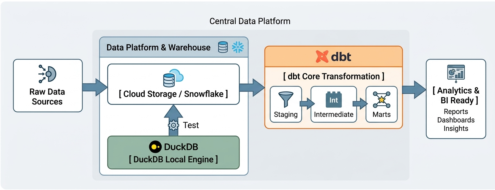

# Hi, I'm Ygor Santos! 👋

---

## 🚀 About Me

Computer Engineer & Data Scientist working as a **Technical Business Analyst**, specializing in **Data Platform Engineering, Analytics Engineering, Software Development, and Systems Architecture**.

With a strong track record of bridging complex business requirements with scalable technical systems, I design and build **modular data pipelines**, **production-grade analytical models**, **custom software solutions**, and **automated cloud infrastructure**.

- 🎓 **Education:** B.S. in Computer Engineering & B.S. in Data Science.

- 🔭 **Current Focus:** Modern Data Stack ecosystems (dbt Core, Snowflake, DuckDB), scalable Python/SQL data engineering, **software development & automation**, and cloud/IaC environments (AWS, Terraform, LocalStack, Docker).

- 🛠️ **Engineering Mindset:** Platform-agnostic, security-conscious, built for long-term maintainability and high availability.

- 🌍 **Work Mode:** Open to global remote engineering roles (worldwide / remote-first culture).

---

<h3 align="left">📐 Data & Platform Architecture Pattern</h3>

  

## 🛠️ Core Technical Stack

### Data Engineering & Platforms

### Software Engineering & Automation

### Cloud Infrastructure & DevOps

---

## 📌 Featured Engineering Projects

### 🔹 [dbt-snowflake-analytics-pipeline](https://github.com/ygor-castro-santos)
> End-to-end, enterprise-grade data transformation architecture using dbt Core and Snowflake. Features multi-layered staging, intermediate business logic, and dimensional data marts optimized for analytical query performance.
* **Tech Stack:** dbt Core, Snowflake, SQL, Python, Git.

### 🔹 [data-infrastructure-labs](https://github.com/ygor-castro-santos)
> Automated infrastructure labs and local data engineering testing suites. Demonstrates cloud service emulation, offline data engines, and workflow automation.
* **Tech Stack:** Python, DuckDB, LocalStack, Terraform, Linux Shell, Docker.

---

## 📈 GitHub Activity & Insights

  
  

---

📫 **Let's Connect!** Feel free to explore my repositories or reach out to collaborate on Data Platform Engineering, Software Development, and Cloud Solutions.
